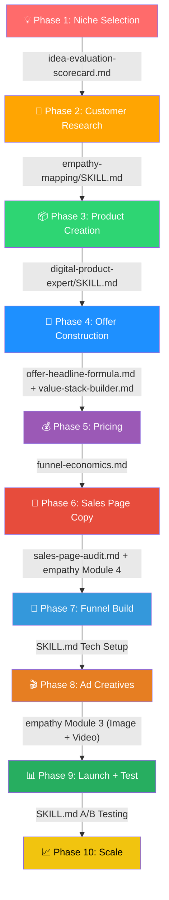

# 🚀 Scratch Se Hero Tak — Complete Digital Product Launch Roadmap

## Tumhare Paas Kya-Kya Assets Hain?

```
📂 .agents/skills/
├── 🧠 digital-product-expert/
│   ├── SKILL.md                    ← Master Brain (5-Day Bootcamp ka poora knowledge)
│   └── references/
│       ├── idea-evaluation-scorecard.md   ← Idea Rating System (8 criteria, weighted /10)
│       ├── offer-headline-formula.md      ← Offer Headline Templates
│       ├── value-stack-builder.md         ← Value Stack Construction Guide
│       ├── sales-page-audit.md            ← 11-Section Sales Page Checker
│       ├── funnel-economics.md            ← Funnel Math & Revenue Calculator
│       └── Digital Dropshipping.md        ← Business Model Overview
│
├── 🗺️ empathy-mapping/
│   ├── SKILL.md                    ← Customer Research System (7 Modules)
│   └── HELPER.md                   ← Easy Guide (tumhare liye)
│
📂 BOOTCAMP-MATERIALS/
├── transcripts/                     ← Day 1-5 Original Transcripts
├── session-notes/                   ← Day 1-5 Session Notes
└── extracted-notes/
    └── all_notes_extracted.txt      ← Saare notes ek jagah

📂 AGENTS.md                        ← Rules (mera behavior control)
📂 HELPER.md                        ← Workspace-level helper
```

---

## 🗺️ THE COMPLETE JOURNEY: 10 Phases — Scratch Se Hero Tak

---

### PHASE 1: 💡 NICHE SELECTION (Day 0) — Beginner-First Approach
> **Goal**: Ek beginner ke liye bina kisi prior experience ke ek high-demand, proven micro-niche finalize karna (jisme real pain + emotional urgency + willingness to pay — teeno ho).

> [!TIP]
> **Beginner Friendly Mindset**: Tumhe kisi field me "expert" hone ki zarurat bilkul nahi hai! Hum 594 Proven Niches aur 500 Ready Ideas me se direct winning micro-niche choose karte hain jahan log already paise kharch kar rahe hain.

**Mai (Manager) Kya Karunga:**

| Step | Action | Kaunsa File / Tool Use Hoga |
|------|--------|----------------------------|
| 1.1 | **Beginner Discovery**: Agar tum bilkul new ho, toh mai direct 3 Big Markets (Health, Wealth, Relationships) me se high-demand micro-niches present karunga. Tumse koi heavy experience nahi mangunga. | Shikshantaram OS (594 Niches DB + 500 Ready Ideas) |
| 1.2 | **Micro-Niche Narrowing**: Generic topic ko beginner-friendly micro-niche me convert karunga (e.g., Wealth → Resume → Shortlist Resume System for Gap Students). | `digital-product-expert/SKILL.md` → Niche Framework |
| 1.3 | **Market Demand Validation**: Web search se verify karunga ki log is problem ke baare me baat/search kar rahe hain ya nahi. | Web Search Tool |
| 1.4 | **Meta Ad Library Proof**: Ad Library me 10+ active ads check karunga — active ads = demand PROVEN (paise ban rahe hain). | `SKILL.md` → Meta Ad Library Validation |
| 1.5 | **Scorecard Rating**: Har idea ko 8 criteria par score karunga (/10) taaki tum blind decision na lo. | `references/idea-evaluation-scorecard.md` |
| 1.6 | **Final Beginner-Ready Selection**: Tumhe 1-2 best options score reasoning ke saath dunga. | Combined Analysis |

**Output**: ✅ Ek finalized, 100% validated micro-niche (7+ score) bina kisi prior experience requirement ke.

---

### PHASE 2: 🧠 CUSTOMER RESEARCH (Day 1)
> **Goal**: Buyer ko itna samajhna ki tumhari copy UNKI language me likhi jaye

**Mai Kya Karunga:**

| Step | Action | Kaunsa File Use Hoga |
|------|--------|---------------------|
| 2.1 | **Customer Avatar** banauga (naam, age, job, daily routine, pains, desires) | `empathy-mapping/SKILL.md` → Module 2, Prompt #1 & #2 |
| 2.2 | **Market Sophistication** + **Awareness Level** identify karunga (Schwartz) | `empathy-mapping/SKILL.md` → Module 2, Prompt #3 & #4 |
| 2.3 | **20 Deep Pain Points** nikaalunga | `empathy-mapping/SKILL.md` → Module 2, Prompt #5 |
| 2.4 | 5 Hook Formats me convert karunga (Pain/Desired/FirstPerson/If-Then/Feeling) | `empathy-mapping/SKILL.md` → Module 2, Prompt #6-#10 |
| 2.5 | **Empathy Map** fill karunga (Thinking/Feeling/Seeing/Saying/Hearing) | `empathy-mapping/SKILL.md` → Module 1 |
| 2.6 | **Winning Message** identify karunga (9 Buying Motivations me se) | `empathy-mapping/SKILL.md` → Module 5 |
| 2.7 | **Awareness Level Deep Dive** (5 Levels × 9 Questions) | `empathy-mapping/SKILL.md` → Module 7 |

**Output**: ✅ Complete buyer profile, 20 pains, 100+ hooks, Empathy Map, Winning Message

---

### PHASE 3: 📦 PRODUCT CREATION (Day 2)
> **Goal**: Ebook/Guide create karna — 30-40 pages, outcome-focused, first-win-in-minutes

**Mai Kya Karunga:**

| Step | Action | Kaunsa File Use Hoga |
|------|--------|---------------------|
| 3.1 | **Problem → Promise → Product** sequence follow karunga | `digital-product-expert/SKILL.md` → Product Creation Framework |
| 3.2 | Before/After mapping (Point A → Point B) | `SKILL.md` → Before/After Situation Mapping |
| 3.3 | Chapter structure design karunga (5-8 chapters, 1 action per chapter) | `SKILL.md` → Ebook Specifics |
| 3.4 | 3 Tests check karunga: Fast? Accurate? Real Problem? | `SKILL.md` → 3 Tests Every Product Must Pass |
| 3.5 | Product name suggest karunga (outcome-based, not topic-based) | `SKILL.md` → Naming Convention |
| 3.6 | Content Thinking vs Product Thinking audit | `SKILL.md` → Content vs Product Thinking Table |

**Output**: ✅ Complete ebook outline, chapter structure, naming, and first-win strategy

---

### PHASE 4: 🎁 OFFER CONSTRUCTION (Day 2-3)
> **Goal**: Ek irresistible offer banana — outcome + speed + certainty + risk reversal

**Mai Kya Karunga:**

| Step | Action | Kaunsa File Use Hoga |
|------|--------|---------------------|
| 4.1 | **4 Components** check karunga (Outcome/Speed/Certainty/Risk Reversal) | `digital-product-expert/SKILL.md` → Offer Construction |
| 4.2 | **Offer Headline** formula se headline generate karunga | `references/offer-headline-formula.md` |
| 4.3 | **Value Stack** banauga (har item named + individually priced) | `references/value-stack-builder.md` |
| 4.4 | **Bonuses** design karunga (2-3 bonuses, "next problem" principle) | `SKILL.md` → Bonus Rules |
| 4.5 | **Guarantee** recommend karunga (unconditional, no conditions) | `SKILL.md` → 4 Types of Guarantees |
| 4.6 | **Hormozi Value Equation** se audit karunga | `SKILL.md` → Hormozi Value Equation |
| 4.7 | **Belief Shift Mapping** karunga (6 belief questions) | `empathy-mapping/SKILL.md` → Module 6 |

**Output**: ✅ Complete offer with headline, value stack (₹2,796+ value → ₹299 price), bonuses, guarantee

---

### PHASE 5: 💰 PRICING STRATEGY (Day 3)
> **Goal**: Launch price set karna + price escalation plan

**Mai Kya Karunga:**

| Step | Action | Kaunsa File Use Hoga |
|------|--------|---------------------|
| 5.1 | Launch price recommend karunga (₹299 starting) | `SKILL.md` → Pricing Framework |
| 5.2 | **Staircase Method** plan banauga (₹299→₹399→₹499→₹699) | `SKILL.md` → Price Anchoring Experiment |
| 5.3 | Order Bump suggest karunga (+₹149-199) | `SKILL.md` → Funnel Architecture |
| 5.4 | Upsell price + concept suggest karunga (3-5x front-end) | `SKILL.md` → Upsell Rules |
| 5.5 | **Complete Funnel Economics** calculate karunga | `references/funnel-economics.md` |

**Output**: ✅ Price ladder: Front-end ₹299 → Bump ₹199 → Upsell ₹999 → Backend ₹4,497

---

### PHASE 6: 📝 SALES PAGE COPY (Day 3-4)
> **Goal**: High-converting sales page copy — 11 sections, CRO optimized

**Mai Kya Karunga:**

| Step | Action | Kaunsa File Use Hoga |
|------|--------|---------------------|
| 6.1 | **11-Section Sales Page** structure follow karunga | `digital-product-expert/SKILL.md` → Sales Page (11 Sections) |
| 6.2 | **Landing Page Copy** generate karunga (11 sections in sequence) | `empathy-mapping/SKILL.md` → Module 4 |
| 6.3 | Headlines (Main + Sub + Supporting) likhuga | Empathy Module 4, Section 1 |
| 6.4 | Benefits, Before/After, USP, Testimonials, Urgency, FAQ — sab | Empathy Module 4, Sections 2-11 |
| 6.5 | **Sales Page Audit** karunga against 11-section checklist | `references/sales-page-audit.md` |
| 6.6 | **Copywriting Rules** check karunga (Benefits vs Features, Buyer Language) | `SKILL.md` → Copywriting Rules |

**Output**: ✅ Complete sales page copy — ready to paste into Lovable/builder

---

### PHASE 7: 🔧 FUNNEL BUILD + TECH SETUP (Day 4)
> **Goal**: Sales page live karna + payment + email delivery + **100% sale tracking (Pixel + CAPI + Webhook)**
> **Cost**: ₹0 (No Lovable / No paid SaaS — sab FREE tools se!)

**Mai Kya Karunga:**

| Step | Action | Tool / File |
|------|--------|-------------|
| 7.1 | **Google AI Studio se complete landing page code** generate karunga (React + Express + Full Funnel) | Google AI Studio (Free) → Complete prompt with sales copy, sections, CRO |
| 7.2 | Generated code ko **GitHub repo me push** karunga (Private Repo) | `git init` → `git push origin main` |
| 7.3 | Locally **clone/download** karke **Antigravity IDE** me open karunga | `git clone` → Open in Antigravity IDE |
| 7.4 | **Antigravity IDE se analyze, iterate, and improve** — design audit, CRO optimization, mobile performance, anti-slop check | Anti-Slop Design Skill + Lighthouse audit |
| 7.5 | Buyer Experience Order check karunga | Sales Page → Checkout (Bumps) → Upsell → Thank You |
| 7.6 | **Tech Stack integrate** karunga (Razorpay, Resend, FB Pixel + CAPI) | `SKILL.md` → Technical Setup Checklist |
| 7.7 | **Pixel + CAPI setup** guidance dunga | `FB DETAILED PIXEL SETUP/capi.md` |
| 7.8 | **🛡️ Razorpay Webhook Setup** (100% sale tracking — CRITICAL!) | See Webhook Checklist below |
| 7.9 | **📧 Email Deduplication Logic** (browser + webhook double-email prevention) | See Webhook Checklist below |
| 7.10 | **🔄 Manual Email Fallback Tool** banauga (emergency backup script) | Standalone `MANUAL-EMAIL-TOOL/send-fulfillment.cjs` |
| 7.11 | Backend product **pre-plan** template fill karunga | `SKILL.md` → Backend Product Pre-Planning |

> [!TIP]
> **Lovable ₹2,000-4,000/month chahta hai har project ke liye. Hamare workflow me ZERO cost hai:**
> - Google AI Studio = FREE (initial code generation)
> - GitHub = FREE (version control + Hostinger auto-deploy)
> - Antigravity IDE = Already have (design iteration + CRO + performance optimization)
> - Result: Mini Wellness jaisi premium site — **₹0 SaaS cost!**

### 🔄 Phase 7 Iteration Cycle (Mini Wellness Proven Workflow):
```
Step 1: Google AI Studio → "Complete React landing page for [product name]"
        ├── Include: All 11 sales page sections
        ├── Include: Checkout page with Razorpay + Order Bumps
        ├── Include: Upsell page + Thank You page
        └── Include: Express server (API endpoints)

Step 2: GitHub Push → Private Repo
        └── git push origin main

Step 3: Clone Locally → Open in Antigravity IDE
        ├── "Analyze this landing page for conversion optimization"
        ├── "Run Lighthouse audit and fix performance issues"
        ├── "Apply anti-slop design principles"
        ├── "Add FB Pixel + CAPI tracking"
        ├── "Add Razorpay Webhook for 100% sale tracking"
        └── "Integrate Resend email with deduplication"

Step 4: Iterate → Push → Deploy
        ├── git push → Hostinger auto-deploy
        ├── Test on mobile (Indian moms = 90% mobile traffic)
        └── Lighthouse score target: 90+ Performance
```

**Output**: ✅ Live funnel: Sales Page → Checkout (Bump) → Upsell → Thank You + **100% Tracking & Email Delivery** — at **₹0 SaaS cost!**

---

### 🛡️ Phase 7.6 — Razorpay Webhook Setup Checklist (MANDATORY for Every New Product!)

> [!CAUTION]
> **MINI WELLNESS LESSON LEARNED**: Bina webhook ke 28% sales (2 out of 7) Meta ko invisible thi kyunki customers ne UPI app se pay karke browser band kar diya tha. Isse Meta ko wrong data mila aur algorithm sahi optimize nahi kar paaya. **YEH STEP KABHI SKIP MAT KARNA!**

#### The Problem (Why Webhook is CRITICAL):
```
Indian Customer UPI se pay karti hai → PhonePe/GPay app khulta hai → UPI PIN dalti hai
→ ₹ Katata Hai (Razorpay ko paisa mil jata hai) ✅
→ BUT: Customer tab swipe/close kar deti hai BEFORE browser callback fires
→ RESULT: Razorpay ke paas paisa hai, lekin:
   ❌ Browser Pixel fire nahi hua → Meta ko sale nahi dikhi
   ❌ CAPI call nahi gayi → Server-side track bhi miss
   ❌ Resend email nahi gaya → Customer ko product nahi mila
```

#### The Fix (Server-to-Server Webhook):
```
Razorpay ke server → Direct hamare server ko bolta hai → "Payment captured!"
→ ✅ CAPI fire hota hai (browser se independent)
→ ✅ Resend email jaata hai (browser se independent)
→ ✅ 100% sales tracked, 100% emails delivered
```

#### Implementation Steps:

**Step 1: Server Code (server.ts me add karna):**
```
POST /api/razorpay-webhook endpoint banao:
├── Razorpay webhook signature verify karo (HMAC SHA256)
├── Event check karo: sirf "payment.captured" process karo
├── CAPI Purchase event fire karo (event_id = "webhook_" + payment_id)
├── Email dedup check karo (in-memory Set se)
│   ├── Agar browser ne pehle bhej diya → Skip email
│   └── Agar browser ne nahi bheja → Webhook se bhejo
└── Always return 200 OK (taaki Razorpay retry na kare)
```

**Step 2: .env me secret add karo:**
```
RAZORPAY_WEBHOOK_SECRET=<from Razorpay Dashboard>
```

**Step 3: Razorpay Dashboard Setup (2 minute):**
```
Razorpay Dashboard → Settings → Webhooks → Add New Webhook
├── Webhook URL: https://YOUR-DOMAIN.com/api/razorpay-webhook
├── Event Select: payment.captured ✅
├── Secret: Auto-generated (copy karke .env me daalo)
└── Save ✅
```

**Step 4: Email Deduplication (Double-Email Prevention):**
```
In-memory Set<string> → emailedPaymentIds
├── /api/verify-payment (browser): Email bhejne ke baad payment_id Set me add karo
└── /api/razorpay-webhook: Pehle Set check karo, agar already hai toh skip karo
```

**Step 5: CAPI Deduplication (Double-Count Prevention):**
```
Browser CAPI event_id = frontend-generated UUID
Webhook CAPI event_id = "webhook_" + razorpay_payment_id
→ Meta auto-deduplicates same user (email+phone) within same timeframe
→ ZERO double counting risk!
```

**Step 6: Amount-Based Smart Folder Link (Fallback):**
```
Agar Razorpay notes me bump info nahi hai, toh amount se guess karo:
├── ₹800+ → Both Bumps folder link
├── ₹650-799 → Single Bump folder link
└── Below ₹650 → Base product folder link
```

**Step 7: Hostinger .env me RAZORPAY_WEBHOOK_SECRET add karo:**
```
⚠️ Local .env me daalne se kaam nahi chalega!
Hostinger Dashboard → Node.js App → Environment Variables me bhi add karo!
```

#### Safety Verification:
| Risk | Mitigation |
|:---|:---|
| Double email to customer | In-memory Set deduplication |
| Double Meta purchase count | Meta auto-dedup (same user + timeframe) |
| Webhook breaks existing flow | Separate endpoint, zero changes to verify-payment logic |
| Server crash from webhook | Full try-catch, always returns 200 |

---

### PHASE 8: 🎬 AD CREATIVES (Day 5)
> **Goal**: Image ads + Video ad scripts ready for FB Ads

**Mai Kya Karunga:**

| Step | Action | Kaunsa File Use Hoga |
|------|--------|---------------------|
| 8.1 | **3 Image Ad Creatives** generate karunga (landing page screenshot → AI) | `SKILL.md` → Ad Creative Generation |
| 8.2 | **5 Image Ad Briefs** banauga (unique angles) | `empathy-mapping/SKILL.md` → Module 3, Part B |
| 8.3 | **5 Video Ad Scripts** likhunga (90-sec, Hinglish) | `empathy-mapping/SKILL.md` → Module 3, Part C |
| 8.4 | **3 Formula-Based Ads** — M=(V-C)×A | `empathy-mapping/SKILL.md` → Module 3, Part A |
| 8.5 | **10 Pain-Based Hooks** generate karunga | `empathy-mapping/SKILL.md` → Module 3, Hook Categories |
| 8.6 | **Ad-Landing Page Congruence** check karunga | `SKILL.md` → Congruence Rule |

**Output**: ✅ 5 Image Ads + 5 Video Scripts + 3 Formula Ads + 10 Hooks — sab ready

---

### PHASE 9: 📊 LAUNCH + TESTING (Day 5-7)
> **Goal**: Ads live karna, 48-hour test, winner identify karna

**Mai Kya Karunga:**

| Step | Action | Kaunsa File Use Hoga |
|------|--------|---------------------|
| 9.1 | **₹200/day** starting budget recommend karunga | `SKILL.md` → Budget Scaling |
| 9.2 | **48-Hour Creative Test** framework follow karunga | `SKILL.md` → 48-Hour Creative Test |
| 9.3 | **3 Angle Testing** guide karunga (Pain/Benefit/Social Proof) | `SKILL.md` → A/B Creative Testing Framework |
| 9.4 | Results analyse karke winner identify karunga | ROAS, CPC, Conversion analysis |
| 9.5 | Agar fail ho toh diagnose karunga: Creative? Offer? Landing Page? | `SKILL.md` → "If ALL 3 fail" checklist |

**Output**: ✅ Winning creative identified, losing ones killed

---

### PHASE 10: 📈 SCALE + BACKEND (Week 2+)
> **Goal**: Revenue scale karna + backend product build karna

**Mai Kya Karunga:**

| Step | Action | Kaunsa File Use Hoga |
|------|--------|---------------------|
| 10.1 | Budget scaling guide karunga (₹200→₹400→₹500→₹2,000/day) | `SKILL.md` → Budget Scaling |
| 10.2 | Price escalation execute karunga (Staircase Method) | `SKILL.md` → Price Anchoring Experiment |
| 10.3 | **First 25 Buyers Feedback Loop** activate karunga (5 questions) | `SKILL.md` → First Buyers Feedback Loop |
| 10.4 | Creative rotation guide karunga (every 7-14 days) | `SKILL.md` → Creative Rotation Rule |
| 10.5 | Backend product plan refine karunga (buyer feedback se) | `SKILL.md` → Backend Product Pre-Planning |
| 10.6 | Revenue tracking + ROAS monitoring | `references/funnel-economics.md` |

**Output**: ✅ Scaling to ₹2,000/day spend, ₹4,000/day revenue = ₹1.2 lakh/month

---

## 🔄 VISUAL FLOW: Kaunsa Skill KAHAN Use Hota Hai



---

## ⏱️ Timeline Summary

| Phase | Duration | Key Deliverable |
|-------|----------|----------------|
| 1. Niche Selection | Day 0 | Finalized micro-niche (7+ score) |
| 2. Customer Research | Day 1 | Avatar + 20 Pains + 100 Hooks + Empathy Map |
| 3. Product Creation | Day 2 | Ebook outline (30-40 pages) |
| 4. Offer Construction | Day 2-3 | Complete offer + value stack + bonuses |
| 5. Pricing | Day 3 | Price ladder (₹299 → ₹4,497) |
| 6. Sales Page Copy | Day 3-4 | 11-section landing page copy |
| 7. Funnel Build | Day 4 | Live funnel + **100% Tracking (Pixel + CAPI + Razorpay Webhook)** |
| 8. Ad Creatives | Day 5 | 5 Image Ads + 5 Video Scripts |
| 9. Launch + Test | Day 5-7 | 48-hour test, winner identified |
| 10. Scale + Backend | Week 2+ | ₹2,000/day spend → ₹1.2L/month |

> [!IMPORTANT]
> **Har phase ke end me mai AUDIT karunga** — bootcamp frameworks ke against check karke bataunga ki kya sahi hai aur kya fix karna hai. Koi bhi step bina quality check ke aage nahi badhega.
