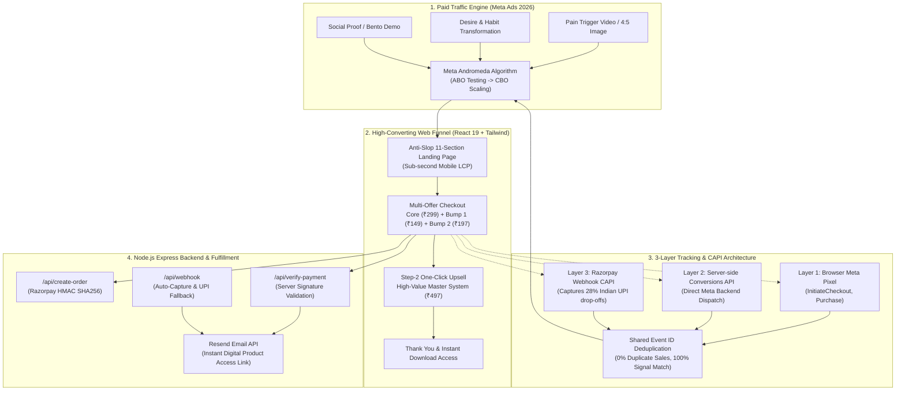

# ⚡ Digital Dropshipping Operating System (OS)
### *The Complete End-to-End Operating System for Scaling Digital Products & Digital Dropshipping in 2026*

[](https://github.com/amangency/digital-dropshipping-os/actions)
[](https://opensource.org/licenses/MIT)
[](https://react.dev/)
[](https://www.typescriptlang.org/)
[](https://tailwindcss.com/)
[](https://business.facebook.com/)
[](https://razorpay.com/)
[](https://resend.com/)

---

## 📖 Executive Summary

The **Digital Dropshipping Operating System** is a complete, production-grade codebase and operational blueprint designed to build, launch, track, and scale digital product businesses (ebooks, toolkits, templates, swipe files, and micro-courses).

Unlike traditional dropshipping which suffers from low margins, physical shipping delays, return-to-origin (RTO) losses, and supplier lock-in, **Digital Dropshipping** delivers:
- **95%+ Gross Margins** (Zero inventory or manufacturing cost).
- **Instant Digital Delivery** via automated email fulfillment.
- **Zero RTO & Shipping Nightmares**.
- **Self-Liquidating Funnels**: The front-end offer + order bumps pay for customer acquisition on Day 1, while Step-2 upsells and backend offers generate pure net profit.

---

## 🏛️ System Architecture



---

## 📂 Repository Structure

```text
digital-dropshipping-os/
├── .agents/                                # AI Co-Pilot & Engineering Rules
│   ├── AGENTS.md                           # Master behavioral rules & stoic guardrails
│   └── skills/
│       ├── anti-slop-design/               # 57-gate audit, design tokens & UI styling
│       ├── digital-product-expert/         # Bootcamp frameworks, scorecard & pricing models
│       ├── empathy-mapping/                # Customer research, avatar psychology & hooks
│       └── Facebook-Ads-mastery/           # Meta Ads 2026, Andromeda AI & scaling rules
│
├── web-engine/                             # Full-Stack Web Application & Funnel
│   ├── public/                             # High-res webp assets, badges, icons
│   ├── src/
│   │   ├── components/                     # Arch dividers, sliders, badges, UI elements
│   │   ├── pages/                          # Landing, Checkout, Upsell, Thank You, Legal
│   │   ├── sections/                       # Hero, Features, Comparison, Testimonials, FAQ
│   │   └── utils/pixel.ts                  # Browser Pixel + Event ID Deduplication
│   ├── server.ts                           # Express backend: Razorpay, Meta CAPI & Resend
│   ├── .env.example                        # Documented environment template
│   ├── package.json                        # Dependencies & build scripts
│   └── vite.config.ts                      # Optimized Vite 6 build configuration
│
├── meta-ads-mastery/                       # Paid Traffic Playbooks & Assets
│   ├── 01-MASTER-CAMPAIGN-BLUEPRINT.md     # 1-1-3 campaign setup, ABO vs CBO, benchmarks
│   ├── 02-HIGH-CONVERTING-VIDEO-SCRIPTS.md # 3-second visual hooks & full scripts
│   ├── 03-AI-IMAGE-AD-PROMPTS.md           # Midjourney/Flux/Ideogram 4:5 prompt formulas
│   ├── 04-WINNING-AD-VAULT-AND-VARIATIONS.md # Anatomy of winning ads & creative matrix
│   └── 05-LAUNCH-CHECKLIST-AND-TROUBLESHOOTING.md # 72-Hour rule & metrics flowchart
│
├── tracking-and-capi/                      # Conversion Tracking & Data Engineering
│   ├── 3-LAYER-TRACKING-ANALYSIS.md        # Browser Pixel + Server CAPI + Webhook guide
│   └── META-CONVERSIONS-API-SETUP.md       # Step-by-step Meta Events Manager setup
│
├── product-and-offer-frameworks/           # Digital Product Strategy & Economics
│   ├── complete-roadmap-overview.md        # 5-Phase End-to-End Execution Roadmap
│   ├── idea-evaluation-scorecard.md        # Weighted scoring matrix for new ideas
│   ├── funnel-economics.md                 # Unit economics & self-liquidating math
│   ├── value-stack-builder.md              # 10x Hormozi value stacking framework
│   ├── incomplete-without-this-upsell-framework.md # Order bump & upsell architecture
│   ├── offer-headline-formula.md           # High-CTR headline formulas
│   └── sales-page-audit.md                 # 11-section sales page audit scorecard
│
├── devops-and-deployment/                  # Cloud Hosting & Production Operations
│   ├── HOSTINGER-DEPLOYMENT-GUIDE.md       # Node.js, PM2, Nginx, SSL on Hostinger VPS
│   └── ENV-VARIABLES-REFERENCE.md          # Complete environment variables guide
│
├── email-fulfillment/                      # Customer Delivery & Transactional Email
│   ├── manual-fulfillment-cli.cjs          # Resend CLI tool for manual/support orders
│   └── README.md                           # Automated vs manual fulfillment guide
│
├── financial-and-unit-economics/           # Accounting, Settlements & Profit Ledger
│   └── FINANCIAL-LEDGER-TEMPLATE.md        # Razorpay fee calculator & settlement tracker
│
├── .gitignore                              # Strict security filters preventing leaks
├── LICENSE                                 # MIT Open Source License
└── README.md                               # Master Documentation (You are here)
```

---

## 🚀 The 5-Phase Execution Blueprint

### Phase 1: Market Empathy & Offer Construction
1. **The Product Triangle**:
   - **Real Pain**: A painful, urgent daily issue that keeps the avatar awake at night.
   - **Emotional Urgency**: Fear of long-term consequences, social comparison, or parental guilt.
   - **Willingness to Pay**: An established demographic actively purchasing solutions in the market.
2. **Hormozi Value Equation**:
   $$\text{Perceived Value} = \frac{\text{Dream Outcome} \times \text{Perceived Likelihood of Achievement}}{\text{Time Delay} \times \text{Effort \& Sacrifice}}$$
3. **The "Incomplete Without This" Upsell Framework**:
   - The Front-End product solves Problem #1.
   - The Order Bump solves the immediately adjacent obstacle.
   - The Step-2 Upsell provides speed, automation, or complete transformation.

### Phase 2: Anti-Slop Web Funnel
- Avoid generic, low-converting AI template designs ("AI slop").
- Implement the **11-Section High-Converting Sales Architecture**:
  1. *Hero Section* (Immediate hook, clear value proposition, hero mockup, trust rating).
  2. *Problem Agitation* (Relatable real-world struggles).
  3. *The Breakthrough / Solution* (The new vehicle).
  4. *Bento Features Grid* (Visually digestible deliverables).
  5. *Comparison Table* (Us vs. The Old Frustrating Way).
  6. *Social Proof Wall* (Verified customer reviews & relatable photos).
  7. *Value Stack & Pricing* (Strikethrough valuation anchor).
  8. *Risk-Free Guarantee* (Unconditional trust anchor).
  9. *FAQ Accordion* (Overcoming final buying objections).
  10. *Author / Mission Story* (Authentic brand identity).
  11. *Sticky Mobile CTA* (Always-present purchase trigger).

### Phase 3: 3-Layer Bulletproof Tracking
- **The Problem**: Browser ad-blockers and iOS privacy restrictions cause **30%–40% of sales data to drop**. Additionally, Indian UPI apps (PhonePe, Google Pay, Paytm) switch away from the browser, causing **28% of paid purchasers to never return to the Thank-You page**.
- **The Solution**: 
  - Direct server-to-Meta API dispatch via Conversions API (CAPI).
  - Razorpay Webhook captures background transactions and dispatches server-side events even if the customer's phone ran out of battery or browser crashed.
  - Meta matches events via `event_id`, eliminating duplicate counts.

### Phase 4: Meta Ads 2026 (Andromeda Engine)
- **1-1-3 Scientific Testing Setup**:
  - 1 Campaign (Sales Objective, ABO baseline @ ₹200–₹500/day).
  - 1 Ad Set (Broad targeting or high-affinity interest pool).
  - 3 Diverse Creatives (Pain-Hook Video, Desire Transformation Video, 4:5 High-CTR Bento Graphic).
- **The 72-Hour No-Touch Rule**:
  - Never edit, pause, or adjust budgets during the first 72 hours of an ad set. Allow the auction algorithm to complete its learning phase without human panic.
- **Stoic Data-Driven Metrics**:
  - **CTR (Link Click)**: Benchmark > 2.0% (Creative Hook Health).
  - **CPM**: Benchmark < ₹350 (Auction Congruence).
  - **CPC (Link)**: Benchmark < ₹15.00 (Traffic Cost Efficiency).
  - **LPV to Purchase CVR**: Benchmark > 4.5%–6.0% (Sales Page Persuasion).

### Phase 5: Automated Fulfillment & Backend Scaling
- Instant transactional emails dispatched within 3 seconds via **Resend**.
- Customers receive clean, branded access to cloud drive folders organized by module.
- Retargeting and email automation nurture buyers into backend courses, toolkits, and communities.

---

## ⚡ 5-Minute Quick Start

### 1. Prerequisites
- **Node.js** >= 18.x
- **npm** >= 9.x
- Razorpay Merchant Account
- Meta Business Manager (Pixel / Data Set ID + Access Token)
- Resend Account (API Key + Verified sending domain)

### 2. Clone & Install
```bash
git clone https://github.com/amangency/digital-dropshipping-os.git
cd digital-dropshipping-os/web-engine
npm install
```

### 3. Environment Configuration
```bash
cp .env.example .env
```
Open `.env` and fill in your keys:
```env
PORT=3000
NODE_ENV=development
APP_URL=http://localhost:3000

# Razorpay Keys
RAZORPAY_KEY_ID=rzp_test_YOUR_ID
RAZORPAY_KEY_SECRET=YOUR_SECRET
RAZORPAY_WEBHOOK_SECRET=YOUR_WEBHOOK_SECRET

# Meta Pixel & CAPI
VITE_FB_PIXEL_ID=YOUR_PIXEL_ID
FB_PIXEL_ID=YOUR_PIXEL_ID
FB_ACCESS_TOKEN=YOUR_META_SYSTEM_USER_ACCESS_TOKEN

# Resend Email
RESEND_API_KEY=re_YOUR_KEY
FROM_EMAIL="Your Brand <orders@yourdomain.com>"
REPLY_TO="support@yourdomain.com"
```

### 4. Run Development Server
```bash
npm run dev
```
Visit `http://localhost:3000` to preview the landing page, checkout, and upsell flows.

### 5. Build & Run Production
```bash
npm run build
npm start
```

---

## 🔒 Security & Privacy Guardrails

This repository is built with enterprise privacy standards:
- **Zero Secrets Committed**: All API keys, tokens, and webhooks are strictly abstracted to environment variables and blocked by root `.gitignore`.
- **Client vs. Server Separation**: Sensitive gateway secrets (`RAZORPAY_KEY_SECRET`) and transactional tokens (`FB_ACCESS_TOKEN`, `RESEND_API_KEY`) are executed purely on the Node server and never exposed to the client bundle.
- **HMAC SHA-256 Signature Verification**: Every payment event and webhook callback is cryptographically verified to prevent payment spoofing or malicious payload injection.

---

## 📄 License

This project is licensed under the **MIT License** — see the [LICENSE](LICENSE) file for full details. You are free to use, modify, and distribute this operating system for your own digital products and client projects.
